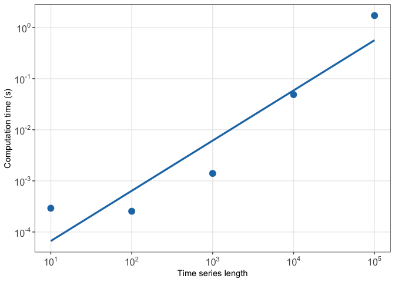

# Rcatch22 

[](https://www.r-pkg.org/pkg/Rcatch22)
[](https://www.r-pkg.org/pkg/Rcatch22)
[](https://zenodo.org/badge/latestdoi/353530083)

R package for the calculation of [22 CAnonical Time-series
CHaracteristics](https://github.com/DynamicsAndNeuralSystems/catch22).
The package is an efficient implementation that calculates time-series
features coded in C.

## Installation

You can install the stable version of `Rcatch22` from CRAN using the
following:

``` r
install.packages("Rcatch22")
```

You can install the development version of `Rcatch22` from GitHub using
the following:

``` r
devtools::install_github("hendersontrent/Rcatch22")
```

You might also be interested in a related R package called
[`theft`](https://github.com/hendersontrent/theft) (Tools for Handling
Extraction of Features from Time series) which provides standardized
access to `Rcatch22` and several other feature sets in both R and Python
for a total of \>6,600 features (including enabling you to calculate
your own custom features).

## Wiki

Please open the included vignette within an R environment or visit the
detailed [`catch22`
gitbook](https://time-series-features.gitbook.io/catch22) for detailed
information on all the features and implementations in various
programming languages.

## Computational performance

With features coded in C, `Rcatch22` is highly computationally
efficient, scaling nearly linearly with time-series size. Computation
time in seconds for a range of time series lengths is presented below.

<!-- -->

## catch24

An option to include the mean and standard deviation as features in
addition to `catch22` is available through setting the `catch24`
argument to `TRUE`:

``` r
features <- catch22_all(x, catch24 = TRUE)
```

## Feature names, masking and single features

Since version 1.0.0 (catch22 v1.0), every feature exactly reproduces a feature of [_hctsa_](https://github.com/benfulcher/hctsa) v3.0.0, so values differ from earlier versions for most features.
Several features were renamed to their _hctsa_ names (e.g., `CO_f1ecac` is now `CO_FirstCrossing_acf_1e_pointOfCrossing`); the old names still work as deprecated aliases.
`catch22_feature_table()` lists each feature's name, short name, name before version 1.0.0, and the _hctsa_ call that reproduces it:

``` r
catch22_feature_table(catch24 = TRUE)
```

Short names (e.g., `trev` for `CO_trev_1_num`) can be added to the output of `catch22_all`, and a single feature can be computed by its name or short name:

``` r
features <- catch22_all(x, short_names = TRUE)
catch22_feature(x, "trev")
```

By default (`mask_nans = TRUE`), a feature that cannot be estimated (e.g., for a constant or very short time series) is set to a fixed value at the appropriate end of its range, so that `catch22_all` always returns real numbers.
Set `mask_nans = FALSE` to get `NaN` for these features instead.
A time series containing `NaN`, `NA` or `Inf` gives `NaN` for every feature (with a warning).

## Citation

A DOI is provided at the top of this README. Alternatively, the package
can be cited using the following:

    To cite package 'Rcatch22' in publications use:

      Henderson T (2026). _Rcatch22: Calculation of 22 CAnonical
      Time-Series CHaracteristics_. R package version 1.0.0.

    A BibTeX entry for LaTeX users is

      @Manual{,
        title = {Rcatch22: Calculation of 22 CAnonical Time-Series CHaracteristics},
        author = {Trent Henderson},
        year = {2026},
        note = {R package version 1.0.0},
      }

Please also cite the original *catch22* paper:

- [Lubba et al. (2019). catch22: CAnonical Time-series
  CHaracteristics.](https://link.springer.com/article/10.1007/s10618-019-00647-x)
